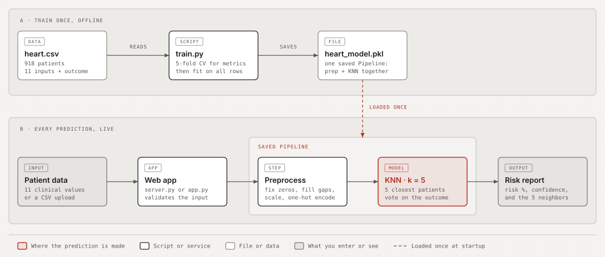

# Heart Disease Prediction

A machine learning web application that estimates whether a patient is at risk of heart disease from 11 clinical measurements. It uses a **K-Nearest Neighbors (KNN)** classifier inside a single scikit-learn **Pipeline**, and ships with two interfaces: a custom **Flask web app** and a **Streamlit app**.

🔗 **Live demo:** https://heart-disease-kt4r.onrender.com/

> ⚠️ **Educational project, not medical advice.** The model is trained on a small public dataset (918 patients) and is not a diagnostic tool. Always consult a qualified healthcare professional.

> ⏳ The live demo runs on a free tier, so the first load after a period of inactivity can take up to a minute while the server wakes up.

---


## Features

- **Single-patient prediction** with a risk result, the 5 similar patients the model compared against, and comparison of the patient's values with the dataset.
- **Batch prediction:** upload a CSV of patients and get a prediction for every row, with the option to download the results.
- **One shared pipeline:** cleaning, imputation, scaling, encoding and the KNN live in one saved object, so the Flask app, the Streamlit app and the training script always behave the same.
- **Honest evaluation:** accuracy is measured with repeated, leak-free cross-validation.
- **Input validation:** the Flask API rejects impossible values with clear error messages.
- **Automated tests** that guard against the preprocessing bugs fixed in this version.

## How it works

<p align="center">
  
</p>

**A. Train once.** `train.py` reads `heart.csv`, scores the model with repeated cross-validation, then fits it on every row and saves the cleaning, scaling, encoding and KNN together as one file, `heart_model.pkl`.

**B. Every prediction.** The web app (Flask or Streamlit) loads that file once. Each patient record is cleaned (0 blood pressure / 0 cholesterol count as missing), imputed, scaled and one-hot encoded, then the 5 most similar patients vote. The risk score is the share of those 5 with heart disease.

Because KNN looks at the 5 nearest patients, the risk score can only be 0%, 20%, 40%, 60%, 80% or 100%. It is a vote share, **not a calibrated probability**.

### Input features

| Feature | Meaning | Values |
|---|---|---|
| `Age` | Age in years | 1 – 120 |
| `Sex` | Sex | `M`, `F` |
| `ChestPainType` | Chest pain type | `ATA` (atypical angina), `NAP` (non-anginal), `ASY` (asymptomatic), `TA` (typical angina) |
| `RestingBP` | Resting blood pressure (mm Hg) | 0 – 300 (0 = not measured) |
| `Cholesterol` | Serum cholesterol (mg/dl) | 0 – 600 (0 = not measured) |
| `FastingBS` | Fasting blood sugar > 120 mg/dl | `0`, `1` |
| `RestingECG` | Resting ECG result | `Normal`, `ST`, `LVH` |
| `MaxHR` | Maximum heart rate achieved | 60 – 220 |
| `ExerciseAngina` | Exercise-induced angina | `N`, `Y` |
| `Oldpeak` | ST depression induced by exercise | -3.0 – 10.0 |
| `ST_Slope` | Slope of the peak exercise ST segment | `Up`, `Flat`, `Down` |

**Target:** `HeartDisease` (1 = disease, 0 = no disease).

## Model performance

Evaluated with **5-fold cross-validation repeated 3 times**. The whole pipeline (imputer, scaler, encoder, KNN) is re-fitted inside every fold, so no information from a validation fold leaks into training.

| Metric | Score |
|---|---|
| Cross-validated accuracy | **0.860 ± 0.021** |
| Out-of-fold accuracy | 0.857 |
| Precision | 0.854 |
| Recall | 0.896 |
| F1 score | 0.874 |

### Model comparison (same pipeline setup, 5-fold CV)

| Model | CV accuracy |
|---|---|
| KNN (k = 5), **deployed** | ~0.86 |
| Logistic Regression | ~0.86 |
| Random Forest | ~0.87 |
| SVM (RBF) | ~0.87 |
| HistGradientBoosting | ~0.87 |

The differences between these models are within the fold-to-fold noise (about ±2 points). KNN was kept because the interface explains each prediction through the 5 similar patients.

## Dataset

- **Source:** the public *Heart Failure Prediction* dataset (combined from five heart disease datasets), 918 records, 11 features plus the target.
- **Class balance:** roughly 55% disease / 45% no disease.
- **Data quirk:** some records have `Cholesterol = 0` or `RestingBP = 0`. These are missing values, and the pipeline imputes them with the median.
- `Frontend/bangladesh_heart_patients.csv` is a 100-row sample file for trying the batch upload.

## Project structure

```
Heart_Disease/
├── README.md
├── CHANGES.md                      summary of the pipeline fix
├── heart.csv                       original dataset
├── Heart_Disease.ipynb             EDA + model comparison notebook
├── docs/
│   └── how-it-works.svg            diagram used in this README
│
└── Frontend/
    ├── heart_model.py              shared preprocessing + model pipeline definition
    ├── train.py                    trains, cross-validates, saves heart_model.pkl
    ├── test_model.py               automated tests (12)
    ├── app.py                      Streamlit app
    ├── server.py                   Flask app + JSON API
    ├── requirements.txt            dependencies
    ├── heart_model.pkl             trained pipeline (created by train.py)
    ├── metrics.json                cross-validated metrics (created by train.py)
    ├── heart.csv                   dataset copy used for training and neighbours
    ├── bangladesh_heart_patients.csv   sample file for batch upload
    └── static/
        ├── index.html              Flask web interface
        ├── app.js
        └── styles.css
```

## Getting started

### Prerequisites

- Python 3.10 – 3.13 (3.12 recommended)
- `pip`

### 1. Install

```bash
git clone <your-repo-url>
cd Heart_Disease/Frontend

python -m venv venv
source venv/bin/activate        # Windows: venv\Scripts\activate

pip install -r requirements.txt
```

### 2. Train the model

```bash
python train.py
```

Expected output (numbers may differ slightly):

```
Repeated 5-fold CV accuracy: 0.8602 +/- 0.0207
Out-of-fold: {'accuracy': 0.8573, 'f1': 0.8742, 'precision': 0.8537, 'recall': 0.8957, ...}
Saved heart_model.pkl and metrics.json (trained on all 918 records)
```

> A pickled model only loads reliably with the **same scikit-learn version** that created it. If you change versions, run `python train.py` again.

### 3. Run an interface

**Flask web app** (custom interface):

```bash
python server.py
# open http://127.0.0.1:8000
```

**Streamlit app:**

```bash
streamlit run app.py
# open http://localhost:8501
```

## Using the app

### Single patient

Enter the 11 values and press predict. You get the predicted class, the vote share, the 5 most similar patients from the dataset, and where the patient sits relative to the rest of the data.

Try these examples:

| Patient | Expected result |
|---|---|
| Defaults (45 y, M, ATA, BP 120, chol 200, no angina, slope Up) | No heart disease (0/5 votes) |
| 65 y, M, ASY, BP 160, chol 280, FBS 1, ECG ST, MaxHR 100, angina Y, Oldpeak 3.0, slope Flat | Heart disease (5/5 votes) |

### Batch prediction

Upload a CSV with these exact column names (extra columns are ignored, order does not matter):

```
Age,Sex,ChestPainType,RestingBP,Cholesterol,FastingBS,RestingECG,MaxHR,ExerciseAngina,Oldpeak,ST_Slope
```

Each row receives a prediction and risk score. Missing columns, invalid category values and out-of-range numbers are reported with the row they occur in.

## API reference

The Flask server exposes a JSON API (base URL: the live demo or `http://127.0.0.1:8000`).

| Method | Endpoint | Purpose |
|---|---|---|
| `GET` | `/api/info` | Model details, feature definitions, defaults, cross-validated metrics |
| `POST` | `/api/predict` | Predict one patient (JSON body) |
| `POST` | `/api/batch/validate` | Validate an uploaded CSV and return a preview |
| `POST` | `/api/batch/predict` | Predict every row of an uploaded CSV |
| `GET` | `/api/sample` | Download the sample CSV |

**Predict one patient:**

```bash
curl -X POST https://heart-disease-kt4r.onrender.com/api/predict \
  -H "Content-Type: application/json" \
  -d '{
    "Age": 65, "Sex": "M", "ChestPainType": "ASY", "RestingBP": 160,
    "Cholesterol": 280, "FastingBS": 1, "RestingECG": "ST", "MaxHR": 100,
    "ExerciseAngina": "Y", "Oldpeak": 3.0, "ST_Slope": "Flat"
  }'
```

The response includes the prediction (`0` or `1`), the risk score, the neighbour votes and the neighbouring patients' profiles. Invalid input returns HTTP `400` with a message, for example `Age must be from 1 to 120`.

**Batch prediction:**

```bash
curl -X POST https://heart-disease-kt4r.onrender.com/api/batch/predict \
  -F "file=@test_patients.csv"
```

## Testing

```bash
cd Frontend
python test_model.py
```

The 12 tests check that:

- a single patient gives exactly the same result as the same patient inside a batch;
- every category is encoded (no all-zero encodings);
- a low-risk and a high-risk patient get the expected predictions;
- `0` cholesterol / blood pressure is treated as missing;
- decimals such as `Oldpeak = 0.9` are not truncated;
- column order and extra columns do not matter;
- cross-validated accuracy stays above 84%;
- the Flask API returns correct predictions, validates input, and matches the pipeline.

## Deployment

### Flask app on Render (used for the live demo)

| Setting | Value |
|---|---|
| Root Directory | `Frontend` |
| Build Command | `pip install -r requirements.txt` |
| Start Command | `gunicorn server:app --bind 0.0.0.0:$PORT --timeout 60` |
| Environment variable | `PYTHON_VERSION` = `3.12.8` |

`gunicorn` must be listed in `requirements.txt`. Pin the same scikit-learn version that was used to run `train.py`.

### Streamlit Community Cloud

1. Push the project to GitHub (including `heart_model.pkl`; make sure `.gitignore` does not exclude `*.pkl`).
2. On https://share.streamlit.io choose **Create app**.
3. Set the main file path to `Frontend/app.py` and select Python 3.12 under *Advanced settings*.

### Railway

Add a `Frontend/Procfile`:

```
web: gunicorn server:app --bind 0.0.0.0:$PORT --timeout 60
```

and set the service's root directory to `Frontend`.

## Design decisions and fixes

This version corrects several problems found in an earlier code review:

| Problem in the original | Fix |
|---|---|
| Streamlit single-patient prediction used `pd.get_dummies(drop_first=True)` on one row, which zeroed **every** categorical feature (accuracy fell to about 67% on real patients) | Fixed-category one-hot encoding inside the pipeline, so one row and a batch are encoded identically |
| `scaler.fit_transform(X_test)` refitted the scaler on the test set and saved the wrong `scaler.pkl` | Scaler is fitted on training data only, inside the pipeline |
| Scaling was applied to the whole dataset before the train/test split (leakage) | All preprocessing happens inside the pipeline, after the split or inside each CV fold |
| `0` cholesterol / blood pressure fed straight to the model | Treated as missing and imputed with the median |
| `.astype(int)` truncated `Oldpeak` and `Cholesterol` | Decimals are kept |
| Three separate pickle files could drift out of sync | A single `heart_model.pkl` pipeline |
| Reported accuracy came from one small test split | Repeated 5-fold cross-validation (about 86%, previously about 82.6% with the flawed setup) |

## Limitations

- Small dataset (918 patients) combined from several sources; results may not generalise to other populations.
- A KNN vote share is not a calibrated probability.
- The model sees only 11 measurements; it cannot replace a clinical examination.
- Roughly 1 in 7 predictions on the training data is wrong (cross-validated accuracy ≈ 86%).
- A pickled model is tied to the scikit-learn version that created it.

## Tech stack

Python · pandas · NumPy · scikit-learn · Flask · Gunicorn · Streamlit · Matplotlib · Seaborn · HTML / CSS / JavaScript

## Troubleshooting

| Problem | Fix |
|---|---|
| `heart_model.pkl` not found | Run `python train.py` inside `Frontend/` |
| `heart.csv not found` | Copy `heart.csv` into `Frontend/` |
| `ModuleNotFoundError: heart_model` | `heart_model.py` must be in the same folder as `app.py` / `server.py` |
| Version warning or model fails to load | Run `python train.py` again with the scikit-learn version you have installed |
| `gunicorn: command not found` on a host | Add `gunicorn` to `requirements.txt` |
| Build fails on very new Python versions | Set the Python version to 3.12 |
| Live demo is slow on first load | The free server is waking up; wait a minute and retry |


## Author

**Soumen Sen**

